# Visualizaciones — GeoC

Diagnósticos exploratorios de las 197 parcelas.

Los experimentos de contaminación deliberada no representan validación predictiva válida.

## error_vs_geographic_neighbor_feature_rank_private

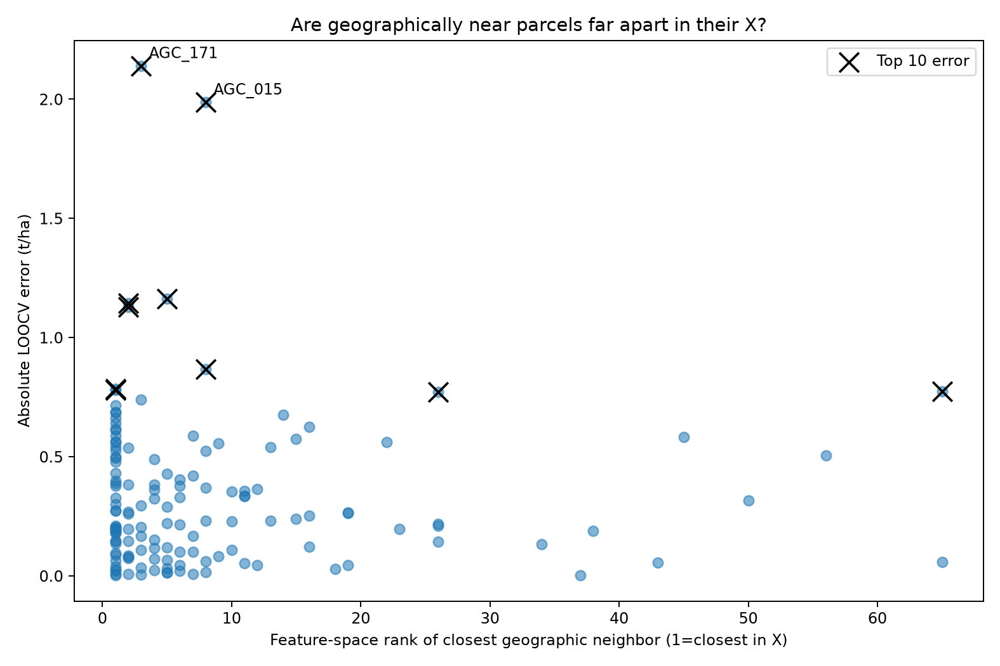

## error_vs_x_5nn_private

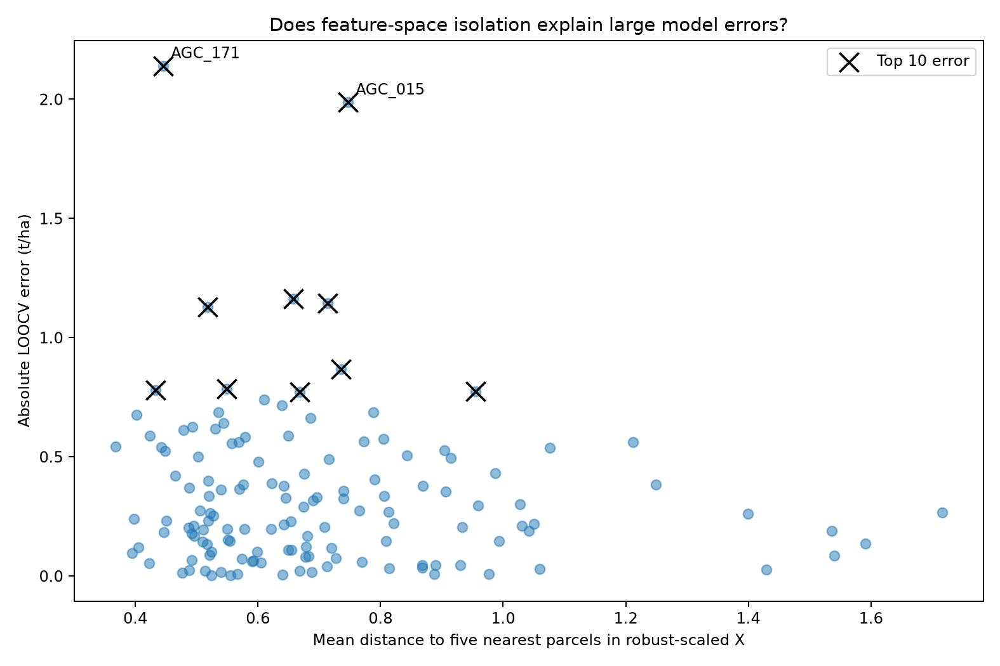

## pca_absolute_private

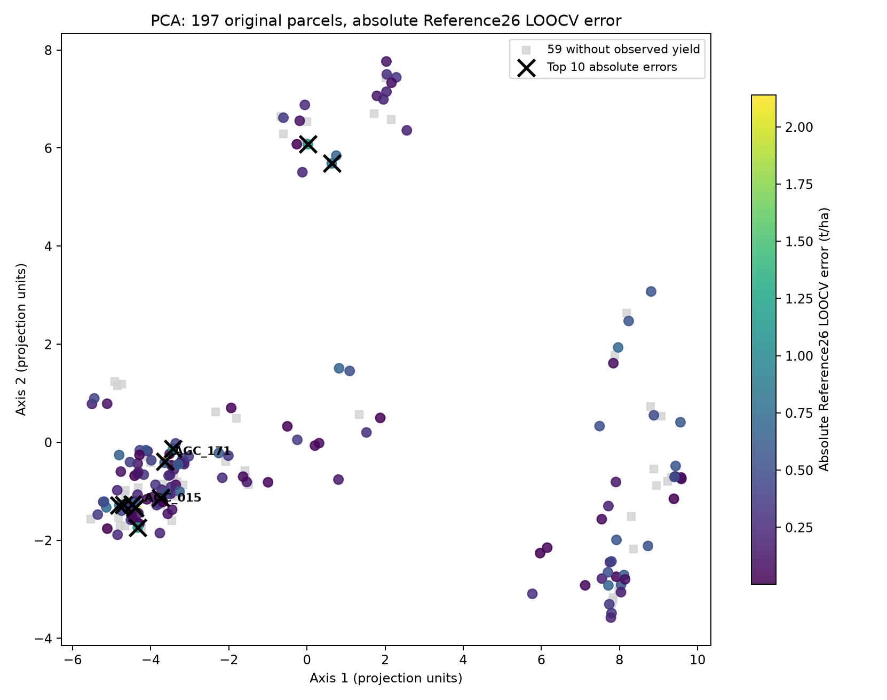

## pca_signed_private

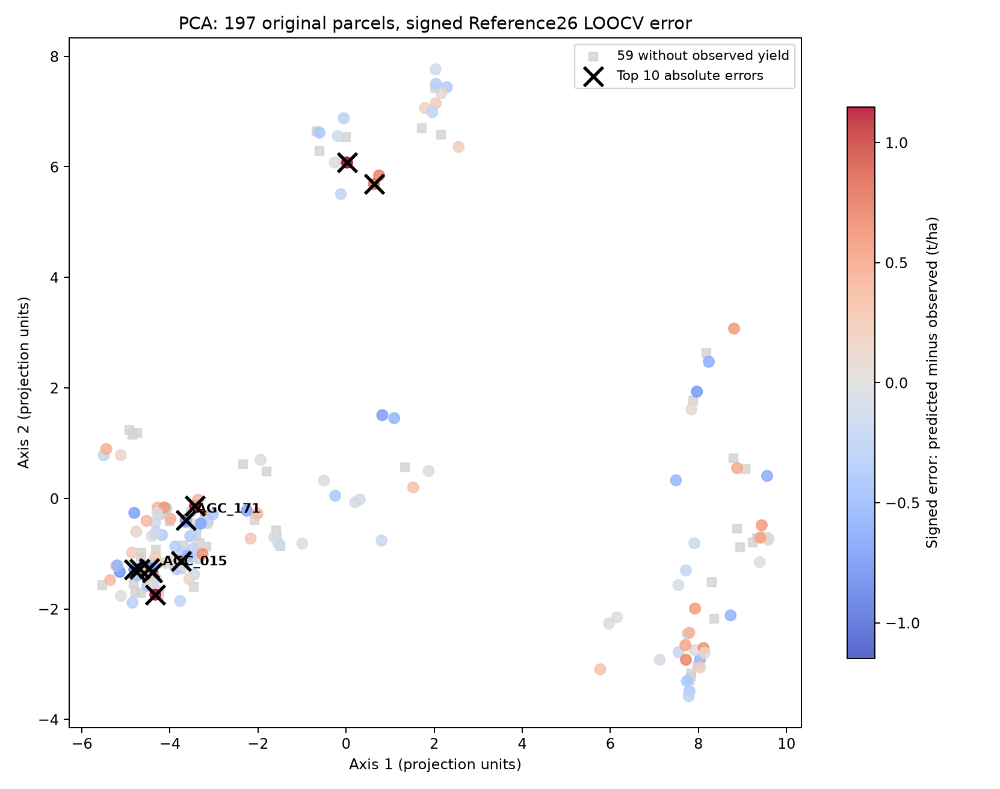

## rmse_distributions_leakage_comparison

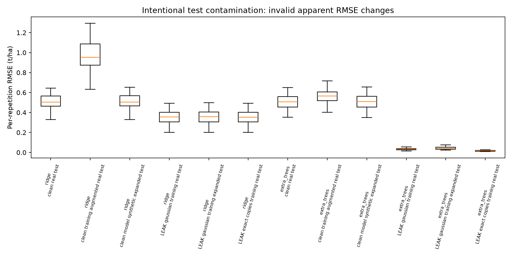

## spatialdistancemds_absolute_private

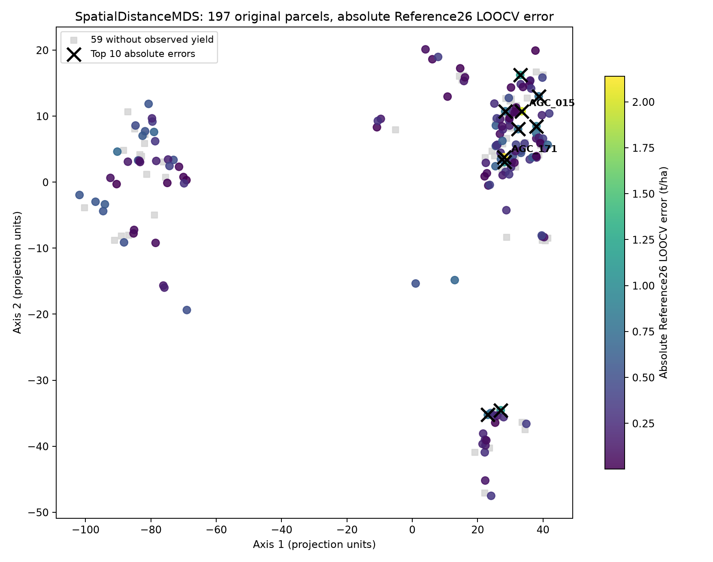

## spatialdistancemds_signed_private

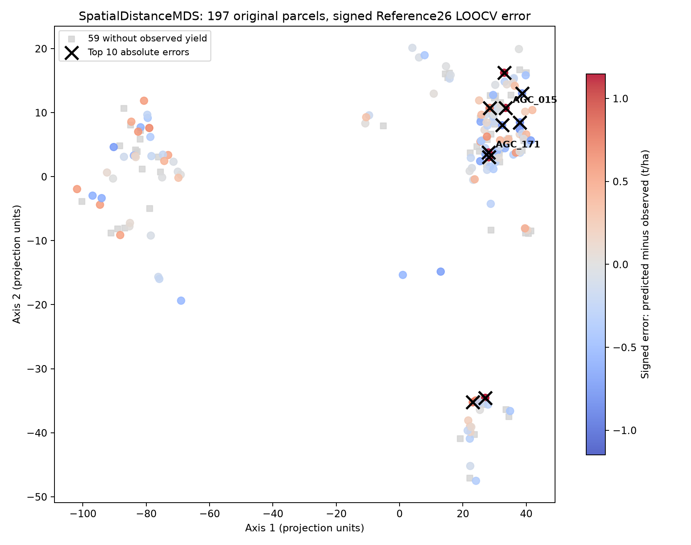

## tsne_absolute_private

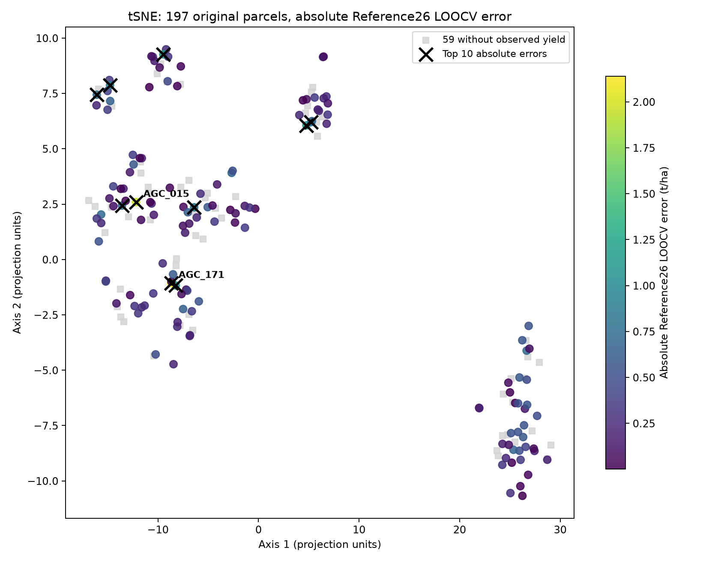

## tsne_signed_private

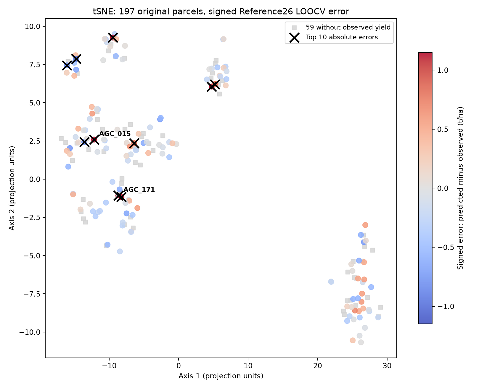

## umap_absolute_private

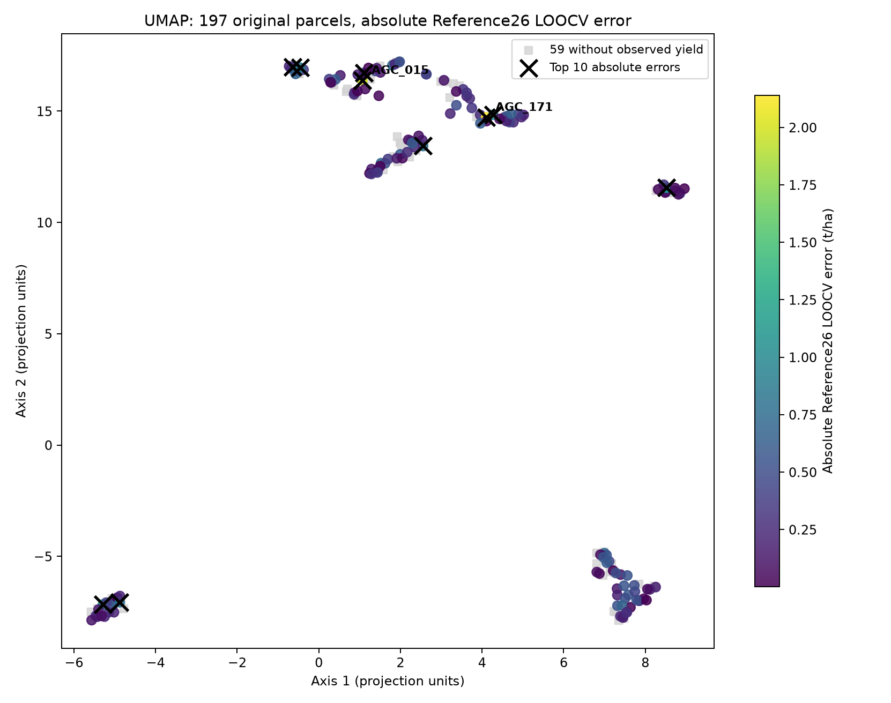

## umap_signed_private

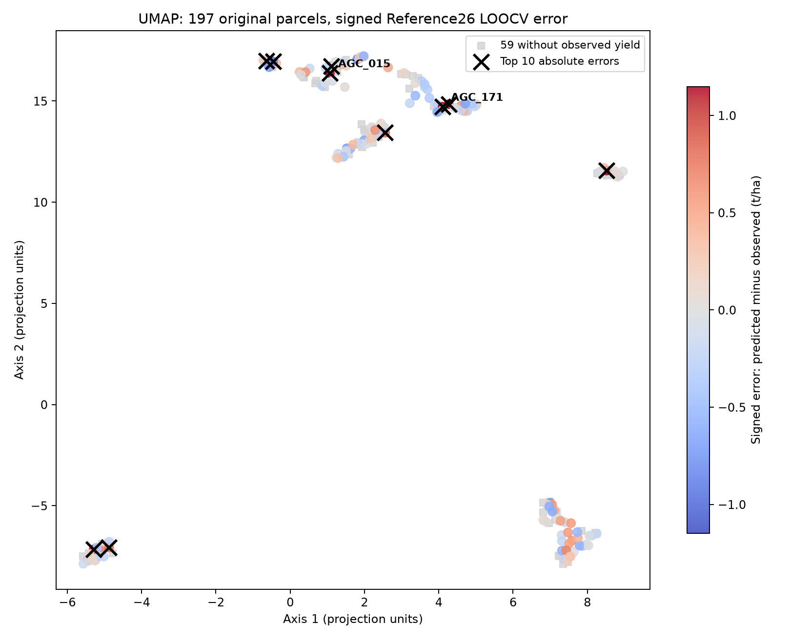

